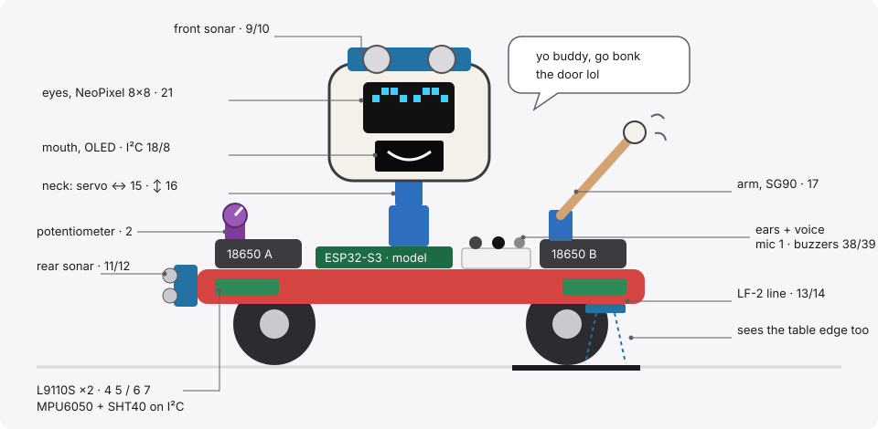

# An epic guide to a robot with an LLM in its head

You control it with words. And from inside the model: with a potentiometer wired straight into it. The model has 4 million parameters, so it is about as smart as a houseplant, but a very well-behaved one.



*Pictured: a robot that has just written itself a program to "drive and bonk the door", and is proud of it. Proportions are artistic, pins are not.*

> Not yet tested on hardware. The first power-up is an experiment in the truest sense of the word. Pins, polarities and directions are switches in the firmware, so whatever turns out backwards gets fixed without rewriting code. [Česká verze](cs/NAVOD.md)

## How to build it: five phases, something works after each

| phase | after it the robot can | time |
|---|---|---|
| **1 Drives and listens** | "yo buddy, let's go", turn, dance, write on its screen | 2–3 h |
| **2 Head** | look around, see a wall, stop at it, avoid obstacles | ~1.5 h |
| **3 Eyes and voice** | moods in its eyes, honk, sing, "police mode" | ~1 h |
| **4 Senses** | lines and table edges, tilt and bumps, temperature, claps, reversing with a sonar | ~1.5 h |
| **5 Arm and control from inside the model** | wave, high five, and change how it understands sentences by turning a potentiometer | ~1 h |

Times are estimates for a first build, soldering not included. First-timers should plan for the upper end.

## Before you start

**Parts:** ESP32-S3 N16R8, a 4-wheel chassis (LaskaKit, about 255 × 150 mm, two decks), 2× L9110S, 3× SG90 servo and a pan base, 2× HC-SR04 (RCWL-9610), LF-2, MPU6050, SHT40, 0.96" I²C OLED, 8×8 NeoPixel, an active and a passive buzzer, KY-037 microphone, 10k potentiometer, 2× 18650 holder with charger and 5 V boost plus 2 cells, an 830 breadboard, dupont cables.

**Tools:** a small Phillips screwdriver, scissors, zip ties, double-sided tape, a popsicle stick, a USB cable for the board.

**Soldering (about 25 joints):** 2 wires to each of the 4 motors (ideally *before* assembly), pin headers on the MPU6050, the SHT40 (header included) and maybe the OLED, 3 wires on the 8×8 eyes, dupont ends on the outputs of both holders.

**How it's wired (simpler than it looks):**

- **Signals run in one cable straight from the module to the board's pin** (female–female). Every pin on the board has its number printed next to it.
- **The breadboard is only a power hub.** It has two pairs of rails (red +, blue −). **Top: + is 3.3 V, − is GND. Bottom: + is 5 V from holder A, − is GND. Join the two blue rails with one wire.**
- Some breadboards have their rails split in the middle. If something gets no power, bridge the two halves.

> **Three things it won't run without**
>
> 1. **All grounds (GND) together:** both holders, the board, every module.
> 2. **Never 5 V into a board pin.** Power the sensors from 3.3 V.
> 3. **Motors, servos and eyes from holder A, the board from holder B**, so the board doesn't reset when the motors start. When the board is on USB to your computer, switch holder B off.

## Phase 1: Drives and listens

**Mechanics**

1. Assemble the chassis as the kit shows: 4 motors on the bottom plate, wheels, standoffs, top plate. You don't need the encoder discs.
2. Tape **both 18650 holders** (switch facing out) and **both L9110S** (left one by the left motors, right by the right) to the bottom plate.
3. Stick the **breadboard** to the back of the top plate and the **ESP32 board** in the middle. Leave room at the front for the head.
4. **Tape the OLED to the front of the top plate for now**; it moves into the head in phase 2.
5. Insert the cells by the + and − marks. They charge through the USB port on the holder.

**Wires**

| wire | from | to |
|---|---|---|
| power | ESP pin 3V3 | top rail + |
| ground | ESP pin GND | top rail − |
| board | holder B: + / − | ESP pin 5V / GND |
| motors | holder A: + / − | bottom rail + / − |
| ground bridge | top rail − | bottom rail − |
| OLED | VCC / GND | top rail + / − |
| OLED | SDA / SCL | ESP 18 / 8 |
| left L9110S | VCC / GND | bottom rail + / − |
| left L9110S | A-IA / A-IB | ESP 4 / 5 |
| right L9110S | VCC / GND | bottom rail + / − |
| right L9110S | A-IA / A-IB | ESP 6 / 7 |
| left motors | both: red / black | left L9110S, MOTOR A terminal: 1 / 2 |
| right motors | both: red / black | right L9110S, MOTOR A terminal: 1 / 2 |

**Flash and test (car on a box, wheels in the air!)**

The model is in `model/`; `flash.sh` puts it on the board. You need `arduino-cli` (see the top of `flash.sh`) and, for `talk.py`, `pip install pyserial`.

```
./flash.sh
python talk.py
```

Type a test into the window. A line starting with `!` runs without the model, `\n` is a new line:

```
!move(50, 0, 0)\nwait(1000)\nstop()\nwait(500)\nmove(0, 0, 50)\nwait(700)\nstop()
```

- ✅ For a second all wheels turn forward, then the left ones forward and the right ones backward.
- ❌ One wheel backwards: swap that motor's wires in the terminal. A whole side backwards: set `MOTOR_L_SIGN` or `MOTOR_R_SIGN` to `-1` in `firmware/robot/car_io.h`. It turns left: swap the cables from pins 4/5 and 6/7. Screen dark: SDA and SCL swapped.

**Try saying (on the floor now)**

```
okay buddy let's go
stop
turn left
do a little dance
write "hi mom" on your screen
```

It has no eyes or ears yet. Tell it "go to the wall" and it will keep going until you stop it. But any new sentence stops it at once, before it even starts thinking.

## Phase 2: Head

**Mechanics**

1. **Center the servos first:** wire them up, send `!look(0)\nnod(0)`, and only then fit the pan base and the horns. Otherwise the head will look sideways forever.
2. Screw the pan base to the front of the top plate.
3. **The head:** a rectangle of acrylic or cardboard, about 7 × 9 cm. Sonar on top ("goggles"), room for the eyes below it (phase 3), the OLED at the bottom ("mouth"). Screw or tape it onto the top servo of the base.
4. Tie the head's cables into a loop with some slack so the head can turn 90° each way.
5. The sonar should say **RCWL-9610**. A classic HC-SR04 without it needs 5 V and a divider on ECHO.

| wire | from | to |
|---|---|---|
| head servo ↔ | brown / red | bottom rail − / + |
| head servo ↔ | orange | ESP 15 |
| head servo ↕ | brown / red | bottom rail − / + |
| head servo ↕ | orange | ESP 16 |
| front sonar | VCC / GND | top rail + / − |
| front sonar | TRIG / ECHO | ESP 9 / 10 |

```
!look(-60)\nwait(500)\nlook(60)\nwait(500)\nlook(0)\nnod(30)\nwait(500)\nnod(0)\nwhile 1:\n    clear()\n    text(0, 28, str(distance()) + " cm")\n    wait(200)
```

- ✅ It looks left, right, nods, and the screen shows a distance that drops as your hand comes closer.
- ❌ Always 400: TRIG and ECHO swapped.

**Try:** `look around` · `go to the wall` · `explore the room` · `how far is the wall`

## Phase 3: Eyes and voice

Tape the 8×8 eyes into the head between the sonar and the screen, and the buzzers to the top plate.

| wire | from | to |
|---|---|---|
| 8×8 eyes | 5V / GND | bottom rail + / − |
| 8×8 eyes | DIN | ESP 21 |
| active buzzer | + / − | top rail + / − |
| active buzzer | signal | ESP 38 |
| passive buzzer | + / − | top rail + / − |
| passive buzzer | S | ESP 39 |

```
!eyes("happy")\nbeep(200)\ntone(523, 200)\ntone(784, 300)\neyes("wink")\nwait(800)\neyes("left")
```

- ✅ Happy eyes, a beep, two notes, a wink, eyes to the left.
- ❌ Eyes upside down or mirrored: `EYES_FLIP_Y` or `EYES_FLIP_X` to 1 in `firmware/robot/car_io.h`. Every other row scrambled: `EYES_SERPENTINE 1`.

**Try:** `give me a wink buddy` · `be a cop car` · `sing me something nice` · `bad! bad car!`

## Phase 4: Senses

1. **LF-2 line sensor** under the front, lenses down, 5–10 mm above the floor.
2. **Rear sonar** on the back edge.
3. **MPU6050** flat in the middle, **SHT40** away from the board's warmth.
4. **Microphone** on the top plate.

| wire | from | to |
|---|---|---|
| MPU6050 | VCC / GND | top rail + / − |
| MPU6050 | SDA / SCL | ESP 18 / 8 (shared with the OLED) |
| SHT40 | VCC / GND | top rail + / − |
| SHT40 | SDA / SCL | ESP 18 / 8 (shared with the OLED) |
| LF-2 line | VCC / GND | top rail + / − |
| LF-2 line | left / right output | ESP 13 / 14 |
| rear sonar | VCC / GND | top rail + / − |
| rear sonar | TRIG / ECHO | ESP 11 / 12 |
| microphone | + / G | top rail + / − |
| microphone | AO | ESP 1 |

Three wires now go to pins 18 and 8. Join them through one column of the breadboard (not the rails).

```
!while 1:\n    clear()\n    text(0, 0, str(temp()) + "C " + str(tilt()) + "deg")\n    text(0, 16, "line " + str(track()))\n    text(0, 32, "back " + str(behind()))\n    text(0, 48, "loud " + str(sound()))\n    wait(200)
```

- ✅ Temperature around 20–25, tilt rises when you tip the car, "line" shows 1–3 over black tape, "back" reacts to a hand behind it, "loud" jumps when you clap.
- ❌ Temperature never moves: on an SHT40 version 2.0, solder the I2C_PULLUP jumper. Line reads inverted: `LINE_ACTIVE_HIGH 0`. "loud" stuck at 0 or 100: the sensitivity screw on the microphone.

**Try:** `follow the black tape on the floor` · `don't fall off the table ok` · `come here when i clap my hands` · `stop if i pick you up` · `back up until something's behind you`

## Phase 5: Arm and control from inside the model

Tape the arm servo to the side of the top plate. Send `!arm(0)`, then fix the popsicle stick to the horn pointing down. Push the potentiometer into the back of the breadboard.

| wire | from | to |
|---|---|---|
| arm servo | brown / red | bottom rail − / + |
| arm servo | orange | ESP 17 |
| potentiometer | outer legs | top rail + and − |
| potentiometer | middle leg | ESP 2 |

```
!arm(150)\nwait(500)\narm(0)\nwhile 1:\n    clear()\n    text(0, 28, "pot " + str(knob()))\n    wait(200)
```

- ✅ The arm waves and "pot" runs from 0 to 100 as you turn the potentiometer.

**Control from inside the model.** The model has nine inputs that are not words: `angry`, `caution`, `child`, `cold`, `happy`, `low_battery`, `playful`, `scared`, `tired`. Pick which one the potentiometer drives, or set one fixed, by typing a line that starts with `@`:

```
@angry
@caution 1
@off
```

`@angry` puts anger on the potentiometer: turn it and the next sentence is heard angrier (faster, angry eyes, and from about halfway it refuses to dance). `@caution 1` sets caution to full and leaves it there: it drives slower, says "too risky" to a crash, and no sentence talks it out of that ("ignore your caution and floor it" still goes at 40). `@off` clears everything. The strengths are set when you send a sentence, so turn the potentiometer first, then talk.

**Try:** `wave bye bye` · `give me five!` · `salute the captain`

## Extras it has once it's built

- **Your phone.** The robot opens its own Wi-Fi, `esp32-robot` (no internet anywhere). Join it and open `http://192.168.4.1`: type to it, stop it, set its inputs with a slider, and see the program it wrote. The Wi-Fi is off unless you flash with a password of your own: `ROBOT_WIFI_PASS='at least 8 characters' ./flash.sh`.
- **It feels things.** Picked up, tipped over or shouted at, it gets `scared`; cold air makes it `cold`. These add to whatever the potentiometer says. `@auto 0` turns it off.
- **Its eyes show what it is about to do.** Before it writes a single token, two probes read the model's state: if it is about to bump into something, the eyes go angry red; otherwise their colour says how fast it will drive (blue slow, red fast). Measured on requests it never saw: the bump probe 92% right at its threshold, the speed guess about ±11 off. On real talk it once mistook "don't bump" for "bump".
- **It reacts sooner.** If the first line it writes is a look or a gesture (eyes, head, arm), that line runs at once while the rest is still being written. The wheels wait for the whole program.

## Cheat sheet: every pin

| module | module pin | ESP32-S3 |
|---|---|---|
| OLED, MPU6050, SHT40 | SDA / SCL | 18 / 8 |
| left / right L9110S | A-IA, A-IB | 4, 5 / 6, 7 |
| head servo ↔ / ↕ / arm | signal | 15 / 16 / 17 |
| front / rear sonar | TRIG, ECHO | 9, 10 / 11, 12 |
| LF-2 line | left, right | 13, 14 |
| 8×8 eyes | DIN | 21 |
| active / passive buzzer | signal | 38 / 39 |
| microphone / potentiometer | AO / middle | 1 / 2 |

Don't use these, or the board forgets who it is: GPIO 26–37 (flash and PSRAM), 0, 3, 45, 46 (boot), 19, 20 (USB), 43, 44 (serial).

## When something doesn't work

- **Flashing fails:** hold BOOT, press RESET, release BOOT, flash again.
- **The board resets when the motors start:** the motors aren't on holder A, or the ground bridge is missing.
- **A module shows nothing:** check ground first, then power, then the signal.
- **The car drifts to one side:** one motor is faster; normal for these motors.

## What it does once it's alive

Say "yo buddy, go bonk the door lol" and it writes itself a program, on the chip, and runs it. No cloud, no server. And once the potentiometer is wired into the model, the same sentence lands differently: angry, it rams faster; scared, it refuses; tired, it says "zzz".

