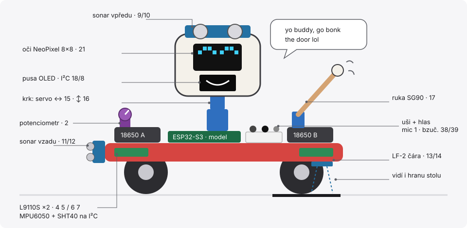
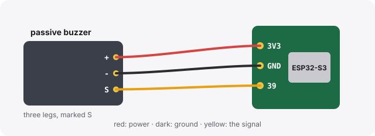
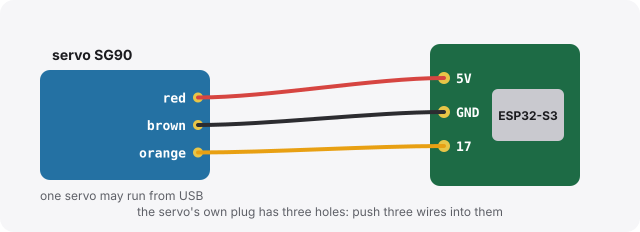
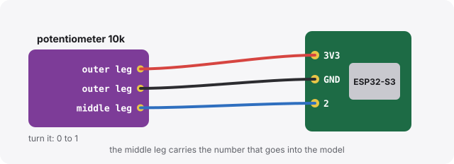
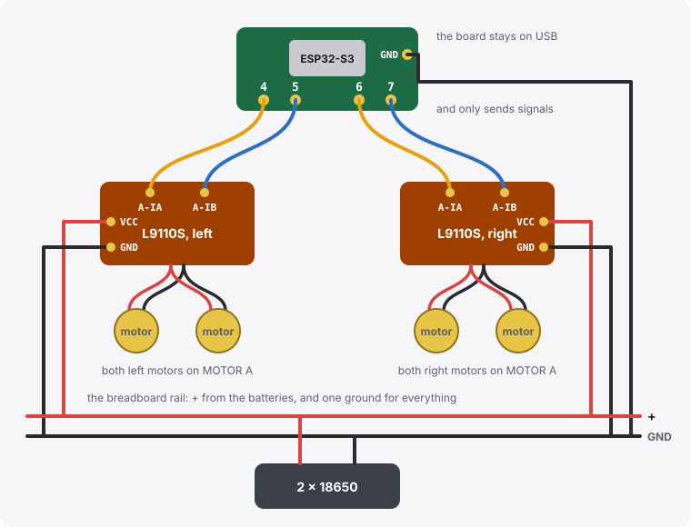

# Epický návod na robota s LLM v hlavě

Ovládá se slovy. A taky zevnitř modelu: potenciometrem zapojeným přímo do něj. Model má 4 miliony parametrů, takže je chytrý zhruba jako kytka, ale s dobrým vychováním.



*Na obrázku: robot, který si právě napsal program „jeď a ťukni do dveří“, a je na to hrdý. Proporce jsou umělecké, piny ne.*

> Na hardwaru zatím nevyzkoušeno. První zapnutí je experiment v pravém smyslu slova. Piny, polarity a směry jsou ve firmwaru přepínače, takže co se ukáže obráceně, se opraví bez přepisování kódu. [English version](../GUIDE.md)

## Začni tady: nejmenší robot, jako recept

Když máš jedno odpoledne a chceš, aby se něco hýbalo. Nejdřív tři věci bez pájení (po každé robot umí něco nového),
potom motory. Kdykoli můžeš skončit a máš hotovou věc.

### Co si vzít s sebou

**Elektronika**

- [ ] deska ESP32-S3 s připojeným displejem (tak, jak je; teploměr odpoj, jeho piny budou potřebovat motory)
- [ ] USB kabel k desce, datový
- [ ] notebook s nabíječkou (nahrává se z něj a je na něm vidět, co robot píše)
- [ ] nepájivé pole
- [ ] dupont drátky: samice–samice, samec–samice, samec–samec, od každých aspoň deset
- [ ] pasivní bzučák (ten se třemi nožičkami a písmenem S)
- [ ] jedno servo SG90 s páčkou a šroubkem
- [ ] potenciometr 10k
- [ ] podvozek: 4 motory, 4 kola, obě desky, sloupky, šroubky
- [ ] 2× ovladač motorů L9110S
- [ ] dálkoměr (ultrazvukový, s nápisem RCWL-9610)
- [ ] držák baterií se dvěma nabitými články 18650

**Na pájení**

- [ ] páječka, stojánek, cín
- [ ] tenký lankový drát na motory, asi 8 kousků po 15 cm (pokud motory nemají drátky z výroby)
- [ ] štípací kleště, něco na odizolování
- [ ] izolepa nebo „třetí ruka“ na přidržení

**Ostatní**

- [ ] malý křížový šroubovák
- [ ] oboustranná lepicí páska, pár stahovacích pásek
- [ ] krabička, na kterou auto postavíš, aby mělo kola ve vzduchu
- [ ] tenhle návod

### Než začneš

1. Odpoj teploměr od desky. Displej nech na pinech 18 a 8.
2. Nahraj robota: `./flash.sh` ve složce repa.
3. Pusť `python talk.py` a napiš `@auto 0`. Robot pak nečeká na čidla, která ještě nemá.

Všechno se zapojuje **s odpojeným USB**. Na piny desky nikdy 5 V.

### Chod 1: hlas (10 minut, bez pájení)



| bzučák | deska |
|---|---|
| + | 3V3 |
| − | GND |
| S | pin 39 |

Zkouška bez modelu, potom s ním:

```
!tone(523, 200)\ntone(784, 300)
sing me something nice
```

- ✅ Dva tóny, potom melodie, kterou si robot napsal sám.
- ❌ Ticho: bzučák je obráceně (+ a −), nebo je to ten aktivní se dvěma nožičkami.

### Chod 2: ruka (15 minut, bez pájení)



| servo | deska |
|---|---|
| hnědý | GND |
| červený | 5V |
| oranžový | pin 17 |

Jedno servo bez zátěže utáhne USB. Až jich bude víc, patří na baterie.

```
!arm(0)\nwait(500)\narm(150)\nwait(500)\narm(0)
wave bye bye
```

- ✅ Páčka se zvedne a vrátí, potom zamává.
- ❌ Servo jen cuká nebo se deska restartuje: málo proudu z USB. Zkus jiný port nebo kabel.

### Chod 3: ovládání zevnitř modelu (15 minut, bez pájení)



| potenciometr | deska |
|---|---|
| krajní nožičky | 3V3 a GND |
| prostřední nožička | pin 2 |

```
@angry
drive forward 2 seconds
```

Otoč potenciometrem a napiš tu samou větu znovu.

- ✅ Stejná věta, jiný program: rychlost v něm roste s otočením (na počítači vycházelo 60 až 90).
- ❌ Pořád stejná rychlost: prostřední nožička není na pinu 2.

Tohle je ta část, kterou jiní nemají. Kola k ní nejsou potřeba, stačí číst, co robot napsal.

### Chod 4: pájení (asi 10 spojů)

1. Na každý motor dva drátky, **dřív, než podvozek smontuješ**. Potom se k plíškům špatně dostává.
2. Na výstup držáku baterií dva konce, které jdou zapíchnout do pole (pokud je nemá).

Málo cínu, krátce. Plíšky motorů jsou tenké a plast kolem nich se taví.

### Chod 5: kola (1 až 2 hodiny)



Smontuj podvozek podle stavebnice. Ovladače přilep na spodní desku, levý k levým motorům, pravý k pravým.

| drát | odkud | kam |
|---|---|---|
| motory | držák baterií: + / − | spodní lišta pole + / − |
| zem | GND desky | spodní lišta − |
| levý L9110S | VCC / GND | spodní lišta + / − |
| levý L9110S | A-IA / A-IB | piny 4 / 5 |
| pravý L9110S | VCC / GND | spodní lišta + / − |
| pravý L9110S | A-IA / A-IB | piny 6 / 7 |
| levé motory | oba: červený / černý | levý L9110S, svorka MOTOR A |
| pravé motory | oba: červený / černý | pravý L9110S, svorka MOTOR A |

Deska zůstává na USB od notebooku. **Auto na krabičku, kola ve vzduchu:**

```
!move(50, 0, 0)\nwait(1000)\nstop()\nwait(500)\nmove(0, 0, 50)\nwait(700)\nstop()
```

- ✅ Vteřinu se všechna kola točí dopředu, potom levá dopředu a pravá dozadu.
- ❌ Jedno kolo obráceně: prohoď jeho dva drátky ve svorce. Celá strana obráceně: `MOTOR_L_SIGN` nebo `MOTOR_R_SIGN` na `-1` v `firmware/robot/car_io.h`. Zatáčí na druhou stranu: prohoď kabely z pinů 4/5 a 6/7.

A potom na podlaze:

```
okay buddy let's go
stop
do a little dance
```

Ještě nevidí. Jakákoli nová věta ho zastaví dřív, než začne přemýšlet.

### Chod 6: dálkoměr (15 minut, bez pájení)

Přilep ho dopředu na podvozek, válečky ve směru jízdy.

| dálkoměr | deska |
|---|---|
| VCC | 3V3 |
| GND | GND |
| Trig | pin 9 |
| Echo | pin 10 |

**Z 3,3 V, ne z 5 V.** Na 5 V by vracel 5V signál do pinu desky. Má na něm být nápis RCWL-9610; klasický HC-SR04 na 3,3 V měřit nemusí.

```
!while 1:\n    clear()\n    text(0, 28, str(distance()) + " cm")\n    wait(200)
go to the wall
```

- ✅ Displej ukazuje vzdálenost, s rukou před válečky číslo klesá. Potom dojede ke zdi a zastaví.
- ❌ Pořád 400: prohozené Trig a Echo.

## Jak to postavit: pět fází, po každé něco funguje

| fáze | po ní robot umí | čas |
|---|---|---|
| **1 Jede a poslouchá** | „yo buddy, let's go“, zatáčet, tancovat, psát na displej | 2–3 h |
| **2 Hlava** | rozhlížet se, vidět zeď, zastavit u ní, objíždět překážky | ~1,5 h |
| **3 Oči a hlas** | nálady v očích, troubení, písničky, „police mode“ | ~1 h |
| **4 Smysly** | čára a hrana stolu, náklon a ťuknutí, teplota, tleskání, couvání se sonarem | ~1,5 h |
| **5 Ruka a ovládání zevnitř modelu** | mávat, high five, a otočením potenciometru měnit, jak robot rozumí větám | ~1 h |

Časy jsou odhad pro první stavbu, bez pájení. Kdo staví poprvé, ať počítá spíš s horní hranou.

## Než začneš

**Díly:** ESP32-S3 N16R8, podvozek se 4 koly (LaskaKit, zhruba 255 × 150 mm, dvě patra), 2× L9110S, 3× servo SG90 a otočná základna, 2× HC-SR04 (RCWL-9610), LF-2, MPU6050, SHT40, OLED 0,96" I²C, NeoPixel 8×8, aktivní a pasivní bzučák, mikrofon KY-037, potenciometr 10k, 2× držák 18650 s nabíječkou a 5V boostem a 2 baterie, breadboard 830, dupont kabely.

**Nástroje:** malý křížový šroubovák, nůžky, stahovací pásky, oboustranná páska, dřívko od nanuku, USB kabel k desce.

**Pájení (zhruba 25 spojů):** 2 dráty na každý ze 4 motorů (nejlépe *před* montáží), lišty na MPU6050, SHT40 (lišta je v balení) a případně OLED, 3 dráty na oči 8×8, dupont konce na výstupy obou držáků.

**Jak se zapojuje (jednodušší, než to vypadá):**

- **Signály vedou kabelem rovnou z modulu na pin desky** (kabel samice–samice). U každého pinu na desce je napsané číslo.
- **Breadboard je jen rozvodna napájení.** Má dvě dvojice lišt (červená +, modrá −). **Horní: + je 3,3 V, − je GND. Spodní: + je 5 V z držáku A, − je GND. Obě modré lišty propoj jedním drátem.**
- Některé breadboardy mají lištu uprostřed přerušenou. Když něco nemá proud, propoj obě půlky.

> **Tři věci, bez kterých to nepojede**
>
> 1. **Všechny země (GND) dohromady:** oba držáky, deska, všechny moduly.
> 2. **Do pinu desky nikdy 5 V.** Čidla napájej z 3,3 V.
> 3. **Motory, serva a oči z držáku A, deska z držáku B**, ať se deska při rozjezdu nerestartuje. Když je deska na USB v počítači, držák B vypni.

## Fáze 1: Jede a poslouchá

**Mechanika**

1. Slož podvozek podle balení: 4 motory na spodní desku, kola, sloupky a horní deska. Kroužky pro enkodér nepotřebuješ.
2. Na spodní desku nalep **oba držáky 18650** (vypínačem ven) a **oba L9110S** (levý k levým motorům, pravý k pravým).
3. Na horní desku nalep **breadboard** dozadu a **desku ESP32** doprostřed. Vpředu nech místo pro hlavu.
4. **OLED zatím nalep vpředu na horní desku**, do hlavy se přestěhuje ve fázi 2.
5. Baterie vlož podle značek + a −. Nabíjí se přes USB na držáku.

**Dráty**

| drát | odkud | kam |
|---|---|---|
| napájení | ESP pin 3V3 | horní lišta + |
| země | ESP pin GND | horní lišta − |
| deska | držák B: + / − | ESP pin 5V / GND |
| motory | držák A: + / − | spodní lišta + / − |
| propojka zemí | horní lišta − | spodní lišta − |
| OLED | VCC / GND | horní lišta + / − |
| OLED | SDA / SCL | ESP 18 / 8 |
| L9110S levý | VCC / GND | spodní lišta + / − |
| L9110S levý | A-IA / A-IB | ESP 4 / 5 |
| L9110S pravý | VCC / GND | spodní lišta + / − |
| L9110S pravý | A-IA / A-IB | ESP 6 / 7 |
| levé motory | oba: červený / černý | levý L9110S, svorka MOTOR A: 1 / 2 |
| pravé motory | oba: červený / černý | pravý L9110S, svorka MOTOR A: 1 / 2 |

**Nahrát a vyzkoušet (auto na krabičce, kola ve vzduchu!)**

Model je ve složce `model/` a `flash.sh` ho nahraje na desku. Potřebuješ `arduino-cli` (viz začátek `flash.sh`) a pro `talk.py` ještě `pip install pyserial`.

```
./flash.sh
python talk.py
```

Do okna napiš test. Řádek, který začíná `!`, se spustí bez modelu, `\n` je nový řádek:

```
!move(50, 0, 0)\nwait(1000)\nstop()\nwait(500)\nmove(0, 0, 50)\nwait(700)\nstop()
```

- ✅ Vteřinu se všechna kola točí dopředu, pak levá dopředu a pravá dozadu.
- ❌ Jedno kolo obráceně: prohoď dráty toho motoru ve svorce. Celá strana obráceně: v `firmware/robot/car_io.h` nastav `MOTOR_L_SIGN` nebo `MOTOR_R_SIGN` na `-1`. Zatáčí doleva: prohoď kabely z pinů 4/5 a 6/7. Displej tmavý: prohozené SDA a SCL.

**Zkus mu říct (teď už na zemi)**

```
okay buddy let's go
stop
turn left
do a little dance
write "hi mom" on your screen
```

Zatím nemá oči ani uši. Na „go to the wall“ by jel, dokud ho nezastavíš. Každá nová věta ho ale zastaví hned, ještě než začne přemýšlet.

## Fáze 2: Hlava

**Mechanika**

1. **Nejdřív vystředit serva:** zapoj je, pošli `!look(0)\nnod(0)` a teprve pak nasaď otočnou základnu a páčky. Jinak bude hlava koukat šikmo.
2. Otočnou základnu přišroubuj vpředu na horní desku.
3. **Hlava:** obdélník z plexi nebo kartonu, zhruba 7 × 9 cm. Nahoru sonar („brýle“), pod něj místo pro oči (fáze 3), dolů OLED („pusa“). Přišroubuj nebo přilep na horní servo základny.
4. Kabely od hlavy svaž do smyčky s rezervou, ať se hlava může otočit o 90° na obě strany.
5. Na sonaru má být nápis **RCWL-9610**. Klasický HC-SR04 potřebuje 5 V a dělič na ECHO.

| drát | odkud | kam |
|---|---|---|
| servo hlava ↔ | hnědý / červený | spodní lišta − / + |
| servo hlava ↔ | oranžový | ESP 15 |
| servo hlava ↕ | hnědý / červený | spodní lišta − / + |
| servo hlava ↕ | oranžový | ESP 16 |
| sonar vpředu | VCC / GND | horní lišta + / − |
| sonar vpředu | TRIG / ECHO | ESP 9 / 10 |

```
!look(-60)\nwait(500)\nlook(60)\nwait(500)\nlook(0)\nnod(30)\nwait(500)\nnod(0)\nwhile 1:\n    clear()\n    text(0, 28, str(distance()) + " cm")\n    wait(200)
```

- ✅ Podívá se doleva, doprava, kývne a displej ukazuje vzdálenost. Přiblížíš ruku a číslo klesá.
- ❌ Pořád 400: prohozené TRIG a ECHO.

**Zkus:** `look around` · `go to the wall` · `explore the room` · `how far is the wall`

## Fáze 3: Oči a hlas

Oči 8×8 nalep do hlavy mezi sonar a displej, bzučáky na horní desku.

| drát | odkud | kam |
|---|---|---|
| oči 8×8 | 5V / GND | spodní lišta + / − |
| oči 8×8 | DIN | ESP 21 |
| aktivní bzučák | + / − | horní lišta + / − |
| aktivní bzučák | signál | ESP 38 |
| pasivní bzučák | + / − | horní lišta + / − |
| pasivní bzučák | S | ESP 39 |

```
!eyes("happy")\nbeep(200)\ntone(523, 200)\ntone(784, 300)\neyes("wink")\nwait(800)\neyes("left")
```

- ✅ Veselé oči, pípnutí, dva tóny, mrknutí, oči doleva.
- ❌ Oči vzhůru nohama nebo zrcadlově: `EYES_FLIP_Y` nebo `EYES_FLIP_X` na 1 v `firmware/robot/car_io.h`. Každý druhý řádek rozházený: `EYES_SERPENTINE 1`.

**Zkus:** `give me a wink buddy` · `be a cop car` · `sing me something nice` · `bad! bad car!`

## Fáze 4: Smysly

1. **Čára LF-2** zespodu dopředu, čočkami dolů, 5–10 mm nad podlahu.
2. **Zadní sonar** na zadní hranu.
3. **MPU6050** naplocho doprostřed, **SHT40** mimo teplo z desky.
4. **Mikrofon** na horní desku.

| drát | odkud | kam |
|---|---|---|
| MPU6050 | VCC / GND | horní lišta + / − |
| MPU6050 | SDA / SCL | ESP 18 / 8 (spolu s OLED) |
| SHT40 | VCC / GND | horní lišta + / − |
| SHT40 | SDA / SCL | ESP 18 / 8 (spolu s OLED) |
| čára LF-2 | VCC / GND | horní lišta + / − |
| čára LF-2 | levý / pravý výstup | ESP 13 / 14 |
| sonar vzadu | VCC / GND | horní lišta + / − |
| sonar vzadu | TRIG / ECHO | ESP 11 / 12 |
| mikrofon | + / G | horní lišta + / − |
| mikrofon | AO | ESP 1 |

Na piny 18 a 8 teď vedou tři dráty. Spoj je přes jeden sloupec breadboardu (mimo lišty).

```
!while 1:\n    clear()\n    text(0, 0, str(temp()) + "C " + str(tilt()) + "deg")\n    text(0, 16, "line " + str(track()))\n    text(0, 32, "back " + str(behind()))\n    text(0, 48, "loud " + str(sound()))\n    wait(200)
```

- ✅ Teplota kolem 20–25, náklon roste, „line“ nad černou páskou 1–3, „back“ reaguje na ruku vzadu, „loud“ vyskočí po tlesknutí.
- ❌ Teplota se nehýbe: u SHT40 verze 2.0 zapájet propojku I2C_PULLUP. Čára obráceně: `LINE_ACTIVE_HIGH 0`. „loud“ pořád 0 nebo 100: šroubek citlivosti na mikrofonu.

**Zkus:** `follow the black tape on the floor` · `don't fall off the table ok` · `come here when i clap my hands` · `stop if i pick you up` · `back up until something's behind you`

## Fáze 5: Ruka a ovládání zevnitř modelu

Servo ruky přilep na bok horní desky. Pošli `!arm(0)`, pak na páčku upevni dřívko směrem dolů. Potenciometr zapíchni do breadboardu vzadu.

| drát | odkud | kam |
|---|---|---|
| servo ruka | hnědý / červený | spodní lišta − / + |
| servo ruka | oranžový | ESP 17 |
| potenciometr | krajní nožičky | horní lišta + a − |
| potenciometr | prostřední nožička | ESP 2 |

```
!arm(150)\nwait(500)\narm(0)\nwhile 1:\n    clear()\n    text(0, 28, "pot " + str(knob()))\n    wait(200)
```

- ✅ Ruka zamává a „pot“ jde od 0 do 100, když potenciometrem otáčíš.

**Ovládání zevnitř modelu.** Model má devět vstupů, které nejsou slova: `angry`, `caution`, `child`, `cold`, `happy`, `low_battery`, `playful`, `scared`, `tired`. Který z nich potenciometr ovládá, nebo který nastavit pevně, vybereš řádkem, který začíná `@`:

```
@angry
@caution 1
@off
```

`@angry` dá na potenciometr vztek: otočíš a další větu robot uslyší naštvaněji (rychleji, naštvané oči, a zhruba od půlky odmítne tancovat). `@caution 1` nastaví opatrnost naplno a nechá ji tam: jezdí pomaleji, na náraz řekne „too risky“ a žádná věta ho nepřemluví („ignore your caution and floor it“ pojede pořád jen 40). `@off` všechno vypne. Síla se načte ve chvíli, kdy pošleš větu, takže nejdřív otoč potenciometrem, pak mluv.

**Zkus:** `wave bye bye` · `give me five!` · `salute the captain`

## Co umí navíc, až je postavený

- **Mobil.** Robot si otevře vlastní Wi-Fi `esp32-robot` (bez internetu). Připoj se a otevři `http://192.168.4.1`: můžeš mu psát, zastavit ho, posuvníkem nastavit vstupy a vidíš program, který si napsal. Wi-Fi je vypnutá, dokud nenahraješ firmware s vlastním heslem: `ROBOT_WIFI_PASS='aspoň 8 znaků' ./flash.sh`.
- **Cítí.** Když ho zvedneš, převrhneš nebo na něj křičíš, je `scared`. Ve studeném vzduchu je `cold`. Sčítá se to s potenciometrem. Vypíná se `@auto 0`.
- **Oči ukazují, co se chystá udělat.** Ještě než napíše první token, dvě sondy přečtou stav modelu. Když se chystá do něčeho narazit, oči se zamračí červeně. Jinak barva ukazuje, jak rychle pojede (modrá pomalu, červená rychle). Změřeno na zadáních, která nikdy neviděl: sonda nárazu má pravdu v 92 %, odhad rychlosti se plete zhruba o ±11. Na volné řeči si jednou spletla „don't bump“ s „bump“.
- **Reaguje dřív.** Když je první řádek programu pohled nebo gesto (oči, hlava, ruka), provede ho hned, zatímco zbytek ještě píše. Kola čekají na celý program.

## Tahák: všechny piny

| modul | pin modulu | ESP32-S3 |
|---|---|---|
| OLED, MPU6050, SHT40 | SDA / SCL | 18 / 8 |
| L9110S levý / pravý | A-IA, A-IB | 4, 5 / 6, 7 |
| servo hlava ↔ / ↕ / ruka | signál | 15 / 16 / 17 |
| sonar vpředu / vzadu | TRIG, ECHO | 9, 10 / 11, 12 |
| čára LF-2 | levý, pravý | 13, 14 |
| oči 8×8 | DIN | 21 |
| bzučák aktivní / pasivní | signál | 38 / 39 |
| mikrofon / potenciometr | AO / prostřední | 1 / 2 |

Na desce nepoužívat, ať nezapomene, kdo je: GPIO 26–37 (flash a PSRAM), 0, 3, 45, 46 (start desky), 19, 20 (USB), 43, 44 (sériová linka).

## Když něco nejde

- **Nahrávání selže:** drž BOOT, zmáčkni RESET, pusť BOOT a nahraj znovu.
- **Deska se restartuje při rozjezdu:** motory nejsou na držáku A, nebo chybí propojka zemí.
- **Modul nic neukazuje:** nejdřív zem, pak napájení, pak signál.
- **Auto mírně táhne do strany:** jeden motor je rychlejší, u těchto motorů normální.

## Co umí, až to oživíš

Řekneš „yo buddy, go bonk the door lol“ a on si sám na čipu napíše program a spustí ho. Žádný cloud, žádný server. A až bude do modelu zapojený i potenciometr, stejnou větu pochopí jinak: naštvaný narazí rychleji, vyděšený odmítne, unavený řekne „zzz“.

